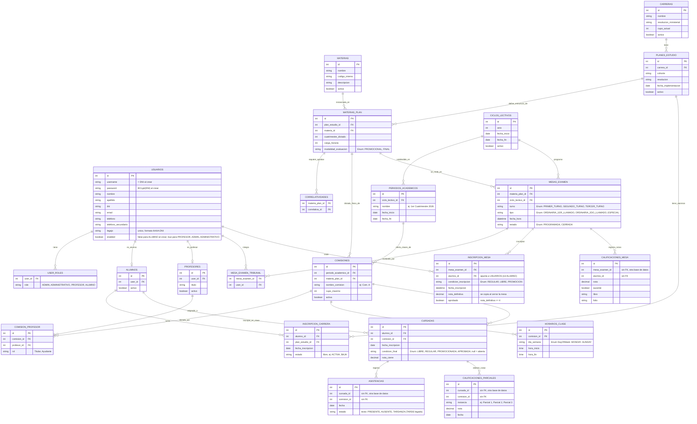

# Modelo de Datos (Diagrama Entidad-Relación)

Este modelo reemplaza la estructura de entidades planas anterior por un diseño jerárquico alineado con los principios de Arquitectura Funcional definidos para el ERP.

## Cambios Arquitectónicos Críticos respecto al modelo anterior:
1. **Desacople de Materias:** `MATERIAS` es ahora un catálogo maestro. La relación con la carrera se da mediante `MATERIAS_PLAN`. Esto evita crear 5 veces "Inglés" si está en 5 carreras.
2. **Contexto Operativo:** Desaparece `CUATRIMESTRES` como tabla aislada y nacen `CICLOS_LECTIVOS` y `PERIODOS_ACADEMICOS`.
3. **Comisiones Contextualizadas:** `COMISIONES` ya no cuelga de una materia suelta, sino de una `MATERIAS_PLAN` dentro de un `PERIODO_ACADEMICO`.
4. **Identidad Unificada (agregado 2026-07-08):** `ALUMNOS`/`PROFESORES` no guardan `dni`/`nombre`/`apellido` propios — son "roles" que apuntan 1:1 a `USUARIOS`, la entidad central de identidad (login, JWT, `legajo` único formato `AAAA-DNI`). Una misma persona puede tener ambos roles sobre el mismo `USUARIOS.id`.

5. **Horarios con hora libre (2026):** `HORARIOS_CLASE` guarda `hora_inicio`/`hora_fin` propios; se eliminó `MODULOS_HORARIO` porque los módulos fijos no cubrían superposiciones reales.
6. **Mesas de examen desacopladas de la cursada:** `MESAS_EXAMEN` cuelga de `MATERIAS_PLAN` + `CICLOS_LECTIVOS`; los finales no son calificaciones parciales, viven en `CALIFICACIONES_MESA` (`ms-notas`).

> Revisado 2026-11-06 contra las entidades JPA de los tres servicios (pendiente #31): horarios con hora libre, mesas de examen, `cupo_actual` en carreras, `comision_id` en asistencias y sin `tipo` en calificaciones parciales. Los nombres son conceptuales: las tablas físicas siguen el naming por defecto de Hibernate (ej. `mesa_examen`, `inscripcion_mesa`, `correlatividades`).

---

