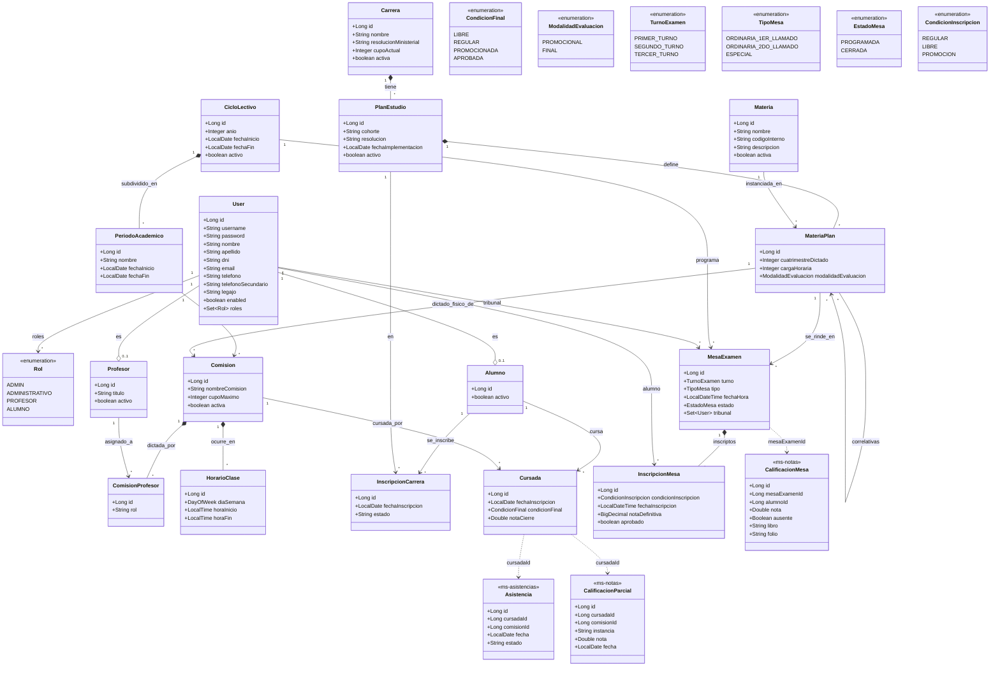

# Diagrama de Clases (Conceptual)

> Revisado 2026-11-06 contra las entidades JPA reales (`backend/core/.../model/`, `backend/commons/.../model/User.java`, `ms-asistencias/.../model/`, `ms-notas/.../model/`; pendiente #31): horarios con `horaInicio`/`horaFin` (sin `ModuloHorario`), mesas de examen y calificaciones de mesa, sin `TipoInstancia` en las calificaciones parciales.

### Notas

- `Cursada.condicionFinal` utiliza el enum `CondicionFinal`. Vale `null` mientras la cursada está abierta; al cerrarla, el Core calcula `LIBRE`, `REGULAR` o `PROMOCIONADA` (`CondicionCursadaService`). `APROBADA` solo se asigna editando la cursada a mano: la aprobación por final queda en `InscripcionMesa.aprobado`.
- `Asistencia.estado` es texto: `PRESENTE`, `AUSENTE`, `TARDANZA` (y `TARDE`, valor legado que se cuenta como tardanza).
- `InscripcionMesa.alumno` apunta directamente a `User` (rol `ALUMNO`), no a la entidad `Alumno`.
- `CalificacionMesa` vive en `ms-notas`; al cerrar la mesa, el Core copia la nota a `InscripcionMesa.notaDefinitiva` y marca `aprobado` si es ≥ 4 y no está ausente.
- `Asistencia`, `CalificacionParcial` y `CalificacionMesa` viven en bases de datos separadas (`db_asistencias`, `db_calificaciones` en microservicios independientes) — la relación con `Cursada` y `Comision` es solo referencial por ID (`cursadaId`, `comisionId`), no por una FK real de base de datos relacional.
