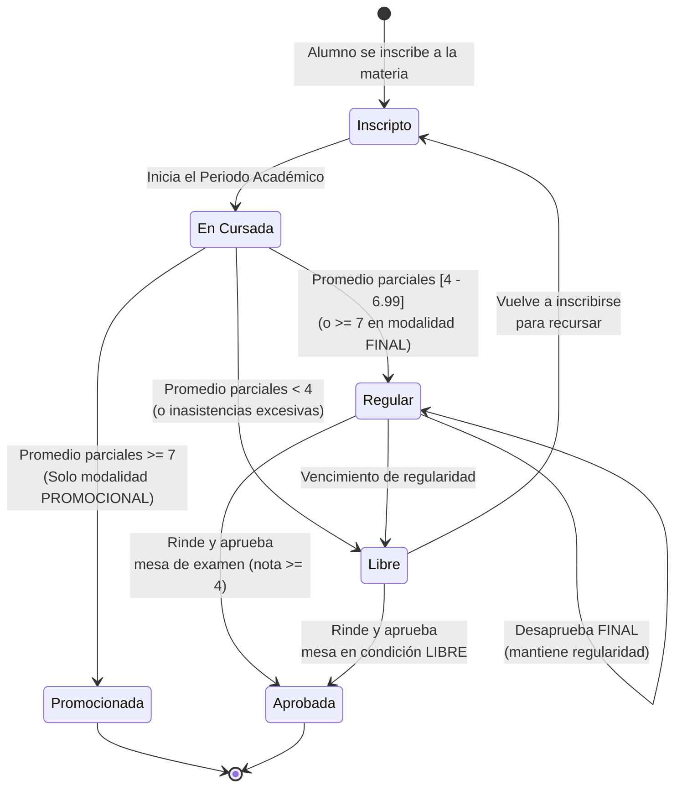

# Diagrama de Estados: Estado Académico del Alumno

Este diagrama modela las transiciones por las que pasa un alumno durante la cursada de una materia, desde su inscripción hasta la aprobación o recursada, cumpliendo con la exigencia del documento de requerimientos.

> **Estado real (revisado 2026-11-06, pendiente #31):** el diagrama es conceptual y mezcla dos cosas que el código guarda por separado:
> - **Condición de la cursada** (`Cursada.condicionFinal`, enum `CondicionFinal`): `null` mientras está abierta. Al cerrarla, `CondicionCursadaService` calcula `LIBRE`, `REGULAR` o `PROMOCIONADA`. Primero mira la **asistencia**: con menos del 70 % queda `LIBRE` aunque el promedio alcance (spec 002, ver [`03.20`](./03.20-Diagrama_Secuencia_Asistencia.md)). Después mira el **promedio de los 3 parciales** y la modalidad (`PROMOCIONAL` o `FINAL`). Una cursada cerrada no se recalcula.
> - **Aprobación por final** (`InscripcionMesa.aprobado`): al cerrar la mesa, el Core marca aprobado si la nota es ≥ 4 y el alumno no estuvo ausente. **La cursada no cambia**: el valor `APROBADA` de `CondicionFinal` solo se asigna editando la cursada a mano. Ver [`03.30`](./03.30-Diagrama_Secuencia_Notas.md).
> - El **vencimiento de la regularidad** no está implementado: es una regla conceptual.

### Reglas de Negocio Representadas:
- Para alcanzar el estado **Regular** o **Promocionada**, el sistema evalúa el promedio de los parciales y la modalidad de evaluación de la materia (`PROMOCIONAL` o `FINAL`).
- Con menos del 70 % de asistencia (la tardanza cuenta como presente), el alumno queda **Libre** al cerrar la cursada, cualquiera sea su promedio.
- Para cerrar la cursada hacen falta asistencias registradas y, si la asistencia alcanza, exactamente 3 parciales.
- Un alumno **Regular** aprueba la materia al aprobar una mesa de examen (nota ≥ 4). Si la desaprueba, mantiene la regularidad (su vencimiento no está implementado).
- Un alumno **Libre** puede inscribirse a una mesa con condición `LIBRE`. Si la aprueba, aprueba la materia.
- No puede inscribirse a una mesa quien ya aprobó la materia (por final o por cursada `PROMOCIONADA`/`APROBADA`), ni hacerlo a menos de 48 h del examen.
- Si un alumno queda **Libre** (y no aprueba un examen libre), puede volver al estado inicial de inscripción para recursar la materia.
