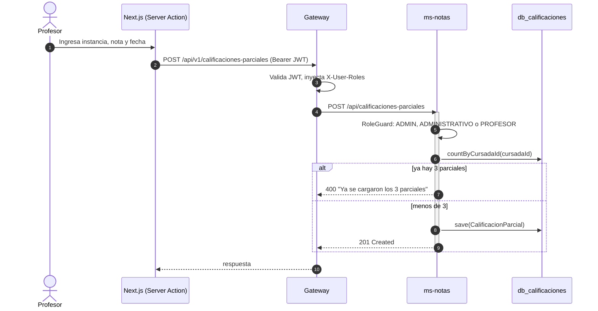
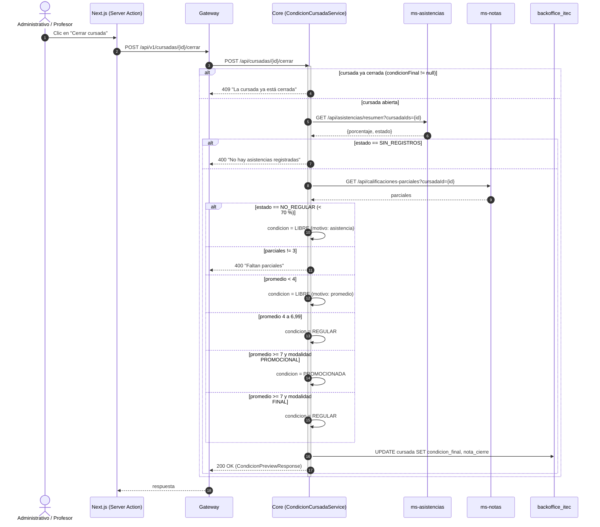
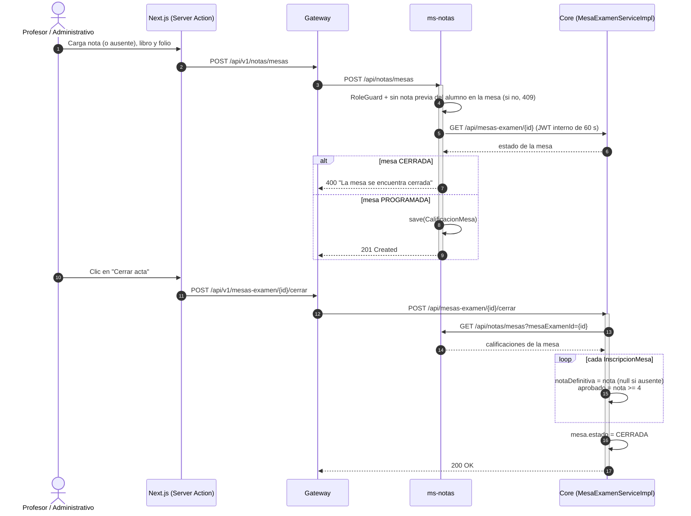

# Diagrama de Secuencia: Calificaciones, Cierre de Cursada y Cierre de Mesa

> Revisado 2026-11-06 contra el código (pendiente #31). La versión anterior (2026-07-12) mezclaba parciales y finales en `CalificacionParcial` y cerraba la cursada solo con las notas. Hoy los parciales y las notas de mesa son entidades distintas en `ms-notas`, y el cierre de cursada consulta primero la asistencia (spec 002).

## 1. Registro de una calificación parcial

El profesor carga los parciales de una cursada en `ms-notas`. El servicio admite como máximo **3 parciales por cursada**. No valida la fecha contra los horarios de la comisión (eso solo lo hace `ms-asistencias`).

## 2. Cierre de cursada (cálculo automático)

El administrativo (o el profesor) previsualiza y cierra la cursada. El Core orquesta: pide la asistencia a `ms-asistencias` y los parciales a `ms-notas`, y calcula la condición según la modalidad de la materia (`CondicionCursadaService`). El detalle del lado de la asistencia está en [`03.20-Diagrama_Secuencia_Asistencia.md`](./03.20-Diagrama_Secuencia_Asistencia.md).

`GET /api/v1/cursadas/{id}/condicion-preview` ejecuta el mismo cálculo sin guardar. Si `ms-asistencias` no responde, el Core devuelve 503 (`AsistenciasClient`). `NotasClient` no traduce la caída de `ms-notas`, que llega como error genérico.

## 3. Nota de mesa de examen y cierre del acta

Los finales no pasan por la cursada: se registran por mesa en `ms-notas` (`CalificacionMesa`) y el Core los consolida al cerrar la mesa.

## Reglas de diseño

- **Separación de responsabilidades:** `ms-notas` almacena las notas (parciales y de mesa). El Core es dueño de las reglas académicas (promedio, modalidad, condición) y orquesta los cierres. `ms-asistencias` calcula la regularidad por asistencia.
- **Cursada y materia son cosas distintas:** el cierre de cursada da solo `LIBRE`, `REGULAR` o `PROMOCIONADA`. La aprobación por final queda en `InscripcionMesa.aprobado`, y la cursada no cambia.
- **Acta cerrada = inmutable:** `ms-notas` consulta el estado de la mesa al Core antes de crear o editar una nota.
- **Seguridad entre servicios:** cuando el Core llama a un MS, manda directamente el header `X-User-Roles: ADMIN` (sin JWT: el MS confía en ese header igual que con el Gateway). Cuando un MS llama al Core, firma un JWT interno de 60 segundos (`InternalTokenService`) con el secreto compartido.
- **Acoplamiento:** estas llamadas sincrónicas en ambos sentidos son la deuda #22 de [`pendientes.md`](./pendientes.md).
